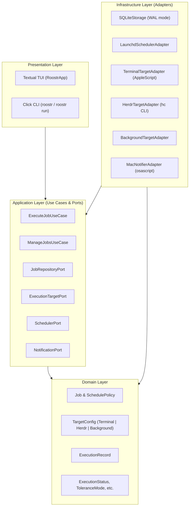

# Roostr 🐓

> Wake up your local AI coding agents on schedule — Terminal & Herdr task runner for macOS.

Roostr is a modern, native scheduler and task runner designed specifically for local AI coding agents (Claude Code, Antigravity CLI, OpenAI Codex, Cursor CLI, custom scripts). It bridges macOS `launchd` system scheduling with an interactive Textual TUI, intelligent catch-up tolerance, and multi-target process execution.

---

## Key Highlights

- **Multi-Target Execution**:
  - **macOS Terminal**: Zero-dependency runner for any macOS user. Launches a new window or tab in Terminal.app, Ghostty, iTerm2, or Kitty, with automatic shell wrapper generation and optional interactive shell retention (`keep_open`).
  - **Herdr App**: First-class integration with [Herdr](https://github.com/tiagoornelas/herdr). Spawns tasks inside designated spaces with custom tab naming templates (e.g. `Daily {DD}/{MM}`) and asynchronous tab renaming.
  - **Background (Daemon)**: Silent headless execution with stdout/stderr redirection to log files and native macOS notifications.
- **Reliable macOS Scheduling**:
  - Automatically writes and loads native `launchd` user launch agents (`~/Library/LaunchAgents/com.tiagoornelas.roostr.{job_id}.plist`).
  - Self-healing execution: Works through macOS sleep/wake cycles.
  - **Tolerance Modes**: Choose between *Catch-up* (runs as soon as the Mac wakes up within a tolerance window) or *Strict* (only runs if the Mac was awake at the exact scheduled time).
- **Idempotency & Sentinel Protection**:
  - Built-in SQLite transaction journal (WAL mode) guaranteeing jobs run at most once per day unless manually triggered.
  - Optional sentinel file templates (e.g. `~/.reports/{YYYY-MM-DD}.md`) to skip redundant agent work.
- **Interactive TUI & Multilingual Support**:
  - Beautiful, fast terminal UI built on Textual.
  - Real-time job inspector, status badges, and execution logs.
  - Switch language at runtime (`l` key) between **English (`en`)**, **Portuguese (`pt_br`)**, and **Spanish (`es`)**.

---

## Architecture

Roostr is built adhering strictly to **Clean Architecture** principles, decoupling business rules from external frameworks, schedulers, and terminal multiplexers:



---

## Installation

### Prerequisites

- macOS 12+ (Monterey or later).
- Python `>= 3.13`.
- [uv](https://github.com/astral-sh/uv) (recommended package manager).

### Install via `uv tool`

```bash
# Clone repository
git clone https://github.com/tiagoornelas/roostr.git
cd roostr

# Install globally into your PATH
uv tool install --editable .
```

Verify your installation:

```bash
roostr --help
```

---

## Getting Started

### 1. Launch the TUI

Simply run:

```bash
roostr
```

Or specify an initial language locale:

```bash
roostr --locale pt_br
```

### Keyboard Shortcuts

| Key | Action | Description |
| :---: | :--- | :--- |
| `n` | **New Job** | Opens modal dialog to configure a new scheduled task |
| `r` | **Run Now** | Immediately triggers the selected job (bypasses schedule/sentinel checks) |
| `p` | **Pause / Resume** | Toggles job activation and synchronizes launchd state |
| `d` | **Delete** | Removes the job, purges history, and unloads launchd agent |
| `t` | **Theme** | Cycles between `night`, `morning`, `tokyo-night`, `nord`, and `dracula` |
| `l` | **Language** | Cycles between English, Brazilian Portuguese, and Spanish |
| `q` | **Quit** | Exits the Roostr TUI |

### Themes

Roostr features a unified, minimalist canvas where sidebar and inspector share the exact same background tone, separated by a crisp border:
- **`night`** (default): Minimalist high-contrast dark theme (deep black `#0a0a0a` canvas, crisp white foreground).
- **`morning`**: Warm pastel yellowish light theme (warm parchment `#faf6ee` canvas, stone-900 high contrast text).
- **`tokyo-night`**: Authentic Tokyo Night palette (`#1a1b26`).
- **`nord`**: Arctic Nord palette (`#2e3440`).
- **`dracula`**: Classic Dracula palette (`#282a36`).

Launch directly with a specific theme:
```bash
roostr --theme morning
# or
roostr -t tokyo-night
```

---

## Execution Targets Explained

### 1. macOS Terminal (`terminal`)
Ideal for standalone workflows or interactive agents where you want to inspect output or interact with prompts.
- **Supported Terminal Emulators**: Terminal.app, Ghostty, iTerm2, Kitty, or Auto-detect.
- **Options**:
  - `app`: Target terminal application.
  - `keep_open`: When `true`, leaves the terminal session open at an interactive shell prompt after the command completes.

### 2. Herdr App (`herdr`)
Tailored for users managing agent workspaces with [Herdr](https://github.com/tiagoornelas/herdr).
- **Options**:
  - `space`: Target workspace space name or ID.
  - `tab_template`: Formatted tab title with time variables (e.g. `Daily {DD}/{MM}` or `Audit {YYYY-MM-DD}`).

### 3. Background (`background`)
Silent headless runner for automated background audits, cron tasks, or headless agents.
- **Options**:
  - `log_file`: Custom path for stdout and stderr (defaults to `~/.local/state/roostr/logs/{job_id}_{YYYY-MM-DD}.log`).

---

## Storage & File Layout

Roostr follows standard XDG Base Directory conventions on macOS:

| Resource | Path | Description |
| :--- | :--- | :--- |
| **Database** | `~/.local/share/roostr/roostr.db` | SQLite database storing jobs, policies, and execution records |
| **Runners** | `~/.local/state/roostr/runners/` | Executable `.command` launcher scripts generated for Terminal targets |
| **Logs** | `~/.local/state/roostr/logs/` | Default background log outputs |
| **LaunchAgents** | `~/Library/LaunchAgents/com.tiagoornelas.roostr.*.plist` | Native macOS launchd definitions |

---

## Development & Testing

```bash
# Install dependencies
uv sync

# Run test suite
uv run pytest

# Check code formatting & linting
uv run ruff check .
uv run ruff format --check .
```

---

## License

MIT License. See [LICENSE](LICENSE) for details.
