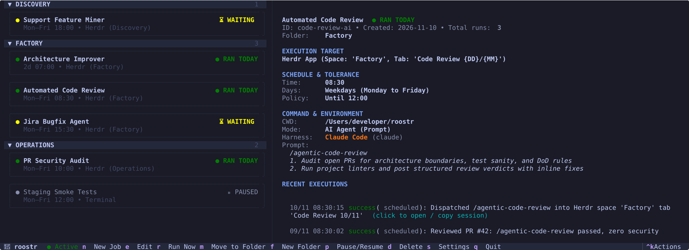

# 🐓 Roostr

> **The ridiculously simple scheduled task runner & software factory alarm for local AI coding agents.**  
> Wake up your autonomous workforce on a routine — dispatching morning PR audits, test suites, and refactorings straight into [Herdr](https://github.com/herdrdev/herdr) workspaces, dedicated terminal tabs, or silent background runs.

---

<p align="center">
  <a href="https://www.python.org/downloads/"></a>
  <a href="LICENSE"></a>
  <a href="https://textual.textualize.io/"></a>
  <a href="https://github.com/herdrdev/herdr"></a>
  <a href="#-supported-ai-harnesses"></a>
  <a href="https://github.com/tiagoornelas/roostr/actions"></a>
</p>

<p align="center">
  
</p>

---

## 🌅 Why Roostr?

Software factories are getting fancy. Cloud orchestration platforms, complex remote graphs, and heavy enterprise pipelines promise autonomy — at the cost of local simplicity, monthly bills, and Docker daemons eating your RAM.

Many of us just want to keep things **simple, local, and running straight inside the CLI harnesses we already trust** (`claude`, `agy`, `cursor`, `codex` — you name it). You do not need an industrial complex when you can run a tidy, well-organized homestead:

- **Roostr 🐓** is the rooster that crows at dawn: waking up your autonomous coding routines right on schedule.
- **Herdr 🐕** is the shepherd: herding active agents into organized workspace tabs where you can visually inspect them.

### Why not just traditional `cron` or raw `launchd`?
- **Mac Sleep & Lid-Close Tolerance:** Standard `cron` fails silently if your MacBook is asleep at 08:30. Roostr's smart tolerance window catches up automatically the moment you open your laptop.
- **Native macOS `launchd` without XML headaches:** Roostr registers directly with macOS `launchd` under the hood. No manual `.plist` editing, no root daemon requirements, and zero background Python processes eating CPU when idle.
- **Visual Terminal Inspections:** Rather than sending output into `/dev/null` or forgotten log dumps, Roostr dispatches routines straight into [Herdr](https://github.com/herdrdev/herdr) agent tabs, interactive terminal windows, or desktop-notified background runs.

---

## ✨ Key Highlights

- **Ridiculously Simple & Local-First:**
  - Installs as a single lightweight CLI tool (`roostr`).
  - Native macOS `launchd` integration — zero third-party background services or Docker daemons.
  - Powered by embedded SQLite (WAL mode) for rock-solid local persistence and idempotency.

- **Dual First-Class Interfaces (TUI & CLI Parity):**
  - **For Humans:** Interactive Textual dashboard (`roostr`) for visual job management, folder navigation, and 1-click execution.
  - **For AI Agents:** Non-interactive Click CLI (`roostr help`, `roostr <cmd> --json`) allowing your AI coding harnesses to discover, configure, inspect, and run routines autonomously.


- **AI-Agnostic Software Factory Runner:**
  - Preconfigured first-class support for **Claude Code** (`claude`), **Google Antigravity** (`agy`), **Cursor** (`cursor`), and **OpenAI Codex** (`codex`).
  - Supports multiline prompt authoring with markdown syntax highlighting directly in the TUI.
  - Also runs any arbitrary shell command or script (`npm test`, `pytest`, `backup.sh`).

- **Flexible Scheduling Possibilities:**
  - **Multiple Daily Runs:** Schedule specific times freely (e.g. `Monday to Friday at 7am, 9:30 am, 2:30 pm, 6 pm`).
  - **Intervals with Active Windows:** Run every `X` hours or minutes, bounded by first and last daily call limits (e.g. `every 30m between 09:00 and 18:00`).
  - **Smart Wakeup Tolerance:** Choose whether missed runs catch up after sleep/power-on (*Catch-up window*) or stay strict (*Exact time only*).

- **Multi-Target Execution:**
  - 🖥️ **Herdr App:** Default visual target. Spawns tasks in designated spaces with template-based tab names (e.g. `{job.name} {DD}/{MM}`), optional interactive shell retention (`keep_open`), and 1-click tab jumping.
  - 💻 **Terminal Emulators:** Launches new windows/tabs in Terminal.app, Ghostty, or iTerm2 with optional interactive shell retention (`keep_open`).
  - 👻 **Background Headless:** Headless process execution with stdout/stderr redirection to log files and desktop notifications.

- **2-Level Folder Organization:**
  - Categorize jobs into collapsible folders and subfolders (e.g. `Work/Daily`, `Finance/Audit`, `OpenSource/Triage`).

- **Interactive TUI & Multilingual Support:**
  - Responsive keyboard-driven interface built on Textual.
  - Real-time inspector, execution history, and 1-click session attach command copy.
  - Switch languages on the fly (`l` key) between **English (`en`)**, **Português (`pt_br`)**, and **Español (`es`)**.
  - Curated themes: `night`, `morning`, `tokyo-night`, `nord`, and `dracula`.

---

## 🚀 Installation & Quickstart

### 1. Installation

Requires macOS and Python `>= 3.13`. Using [uv](https://github.com/astral-sh/uv) or [pipx](https://github.com/pypa/pipx) is recommended:

```bash
# With uv (recommended)
uv tool install roostr

# Or with pipx
pipx install roostr

# Or directly from the GitHub repository
uv tool install git+https://github.com/tiagoornelas/roostr.git
```

Verify your installation:

```bash
roostr --version
```

### 2. For Humans: Interactive TUI Dashboard

Launch the visual dashboard for keyboard-driven job configuration, real-time inspection, and folder organization:

```bash
roostr
```

- Press `n` to create a new routine (e.g. a morning PR review with Claude or Antigravity).
- Press `r` to immediately test-run the selected job.
- Press `m` to move the selected job into a folder or subfolder.
- Press `f` to create a new 1st or 2nd level folder.
- Press `p` to pause or resume a routine.
- Press `q` to exit.

### 3. For AI Agents: Autonomous CLI Manipulation

You can ask any AI coding agent (Claude Code, Google Antigravity, Cursor, OpenAI Codex) to inspect, configure, trigger, and reorganize your routines directly on your behalf.

AI agents discover all available commands, options, and parameters using `roostr help`:

```bash
# Discover top-level capabilities
roostr help

# Learn how to manage routines or folders
roostr help job
roostr help folder

# Inspect detailed flags and validation for creating routines
roostr job create --help
```

#### Machine-Readable Structured Output (`--json`)

Every inspection and mutation command supports `--json` so AI agents receive clean, structured data for programmatic reasoning:

```bash
# List all routines (returns structured JSON array)
roostr job list --json

# Trigger a routine immediately or run all due routines right now
roostr run <job_id>
roostr run --due

# Create a new scheduled routine programmatically
roostr job create \
  --name "Morning PR Review" \
  --prompt "Review open pull requests" \
  --harness claude \
  --target herdr \
  --times "08:00,14:00" \
  --days "mon,tue,wed,thu,fri" \
  --folder "Work/Daily" \
  --json

# Inspect job details and execution history
roostr job show <job_id> --json
roostr history <job_id> --json

# Pause or resume routines
roostr job pause <job_id> --json
roostr job resume <job_id> --json
```

### 4. Activate the Background Daemon

To ensure your routines run automatically on schedule while your terminal is closed, install the native macOS `launchd` service:

```bash
roostr daemon install
```

Check service status at any time:

```bash
roostr daemon status
# ● Roostr daemon is running (loaded in launchd).
```

To remove or disable the service:

```bash
roostr daemon uninstall
```


---

## 🤖 Supported AI Harnesses

Roostr compiles prompts directly into standard CLI invocations for your favorite coding tools:

| Harness | CLI Command | Typical Software Factory Task |
| :--- | :--- | :--- |
| **Claude Code** | `claude 'prompt'` | Daily PR triage, backlog refinement, commit audits |
| **Antigravity** | `agy 'prompt'` | Autonomous subsystem redesigns, deep architecture sweeps |
| **Cursor CLI** | `cursor 'prompt'` | Rapid multi-file test-driven implementations |
| **OpenAI Codex** | `codex 'prompt'` | Boilerplate generation, schema migration reviews |
| **Custom Shell** | `/bin/zsh -c '...'` | Build verification, container health checks, database backups |

---

## 🎯 Execution Targets

### 1. Herdr App (`herdr`) — Default
Designed for developers managing multi-agent spaces in [Herdr](https://github.com/herdrdev/herdr).
- Spawns agent tasks in designated spaces.
- Dynamic tab templates with date interpolation (e.g. `{job.name} {DD}/{MM}`).
- **Interactive shell retention:** Keeps the workspace tab open as an interactive shell after the command or agent exits (`keep_open: true`).
- Jump directly to the active agent tab with a single click from the Roostr inspector.

### 2. Terminal Emulators (`terminal`)
Ideal when you want dedicated windows or tabs for immediate terminal interaction.
- **Supported:** Terminal.app, Ghostty, iTerm2, or auto-detect.
- **Interactive shell retention:** Keeps the terminal session open after command execution (`keep_open: true`).

### 3. Background Headless (`background`)
Silent headless runner for automated background audits, cron tasks, or headless agents.
- Redirects stdout and stderr to dedicated log files (`~/.local/state/roostr/logs/`).
- Desktop notifications on completion or failure.

---

## ⌨️ Keyboard Navigation

| Key | Action | Description |
| :---: | :--- | :--- |
| `n` | **New Job** | Opens the responsive tabbed creation modal |
| `r` | **Run Now** | Immediately triggers the selected job |
| `m` | **Move** | Moves the selected job into a folder or subfolder |
| `f` | **New Folder** | Creates a new 1st or 2nd level folder |
| `p` | **Pause / Resume** | Toggles job activation |
| `d` | **Delete** | Deletes the selected job or empty folder |
| `s` | **Settings** | Opens theme and language preferences dialog |
| `l` | **Language** | Cycles between English, Português, and Español |
| `t` | **Theme** | Cycles between curated color themes |
| `q` | **Quit** | Exits the application |

---

## 📁 Storage Layout

Roostr follows standard XDG Base Directory conventions:

| Resource | Path | Description |
| :--- | :--- | :--- |
| **Database** | `~/.local/share/roostr/roostr.db` | Embedded SQLite database (WAL journal mode) |
| **Logs** | `~/.local/state/roostr/logs/` | Standard output and error logs from background runs |
| **Runners** | `~/.local/state/roostr/runners/` | Generated executable scripts for terminal sessions |

---

## 🤝 Contributing

Contributions are welcome! Please read [CONTRIBUTING.md](CONTRIBUTING.md) for details on code style, testing, and our pull request workflow.

> [!IMPORTANT]
> Requests for adding new AI harnesses must be submitted as an Issue first before opening a Pull Request.

---

## 📄 License

MIT © [Tiago Ornelas](https://github.com/tiagoornelas). See [LICENSE](LICENSE) for details.
